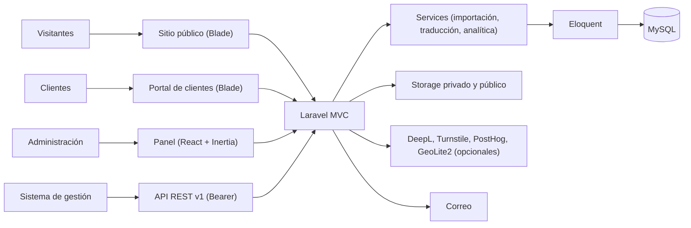
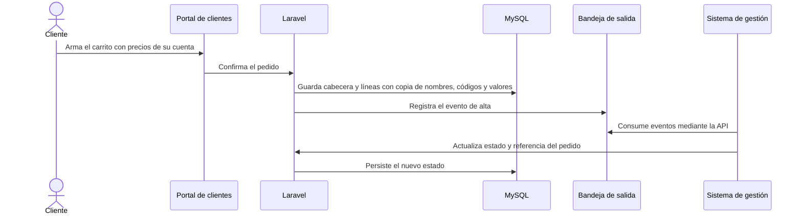
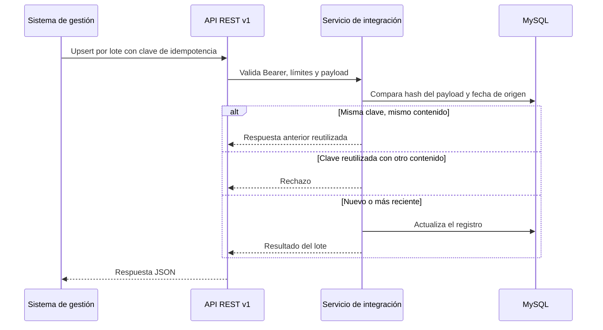
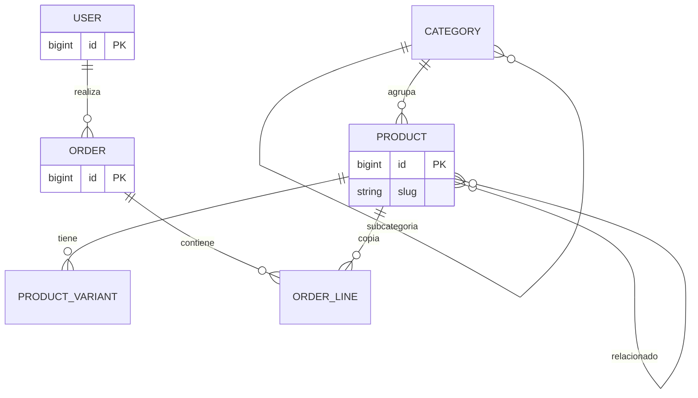

<div align="center">

<br/>

**Plataforma corporativa y comercial: sitio bilingüe, catálogo técnico, portal de clientes, pedidos y API de integración.**


</div>


##  Contenido

[El problema](#-el-problema) · [La solución](#-la-solución) · [Funcionalidades](#-funcionalidades) · [Arquitectura](#-arquitectura) · [Flujos de trabajo](#-flujos-de-trabajo) · [Modelo de datos](#-modelo-de-datos) · [Criterios y decisiones](#-criterios-y-decisiones) · [Stack](#-stack) · [Estructura](#-estructura-del-repo) · [Puesta en marcha](#-puesta-en-marcha) · [Pruebas y calidad](#-pruebas-y-calidad) · [Despliegue](#-despliegue) · [Estado y pendientes](#-estado-y-pendientes) · [Licencia y autoría](#-licencia-y-autoría)


##  El problema

La empresa tenía su catálogo industrial repartido entre hojas de cálculo, un sitio institucional y procesos manuales para cotizar, vender a clientes con precios distintos y llevar pedidos. Cada cambio de precio, de stock o de ficha técnica se repetía en varios lugares, y el sistema de gestión de la empresa no recibía la información comercial de forma ordenada.

##  La solución

**FITINOX** es una aplicación Laravel con cuatro zonas:

- **Sitio público** en español e inglés, renderizado con Blade: institucional, catálogo jerárquico con variantes técnicas, fichas PDF, distribuidores y presupuestos.
- **Portal de clientes**: registro con aprobación, precios y listas privadas por cuenta, carrito, pedidos y comprobantes.
- **Panel administrativo** con React e Inertia: CMS, catálogo, inventario, clientes, pedidos, newsletter y analítica.
- **API REST versionada** para que el sistema de gestión externo sincronice artículos, clientes, stock, eventos comerciales y estados de pedidos.

Roles: superadministración, administración, edición de contenido y clientes.


##  Funcionalidades

**Sitio público** (rol: visitante)
- Contenido institucional bilingüe con traducciones persistidas y uso opcional de DeepL.
- Catálogo con categorías jerárquicas, productos relacionados, variantes, características técnicas, búsqueda y fichas PDF.
- Solicitudes de presupuesto, mensajes de contacto y enlaces configurables de WhatsApp.
- Newsletter con suscriptores, bajas, campañas y registro de entregas.

**Portal de clientes** (rol: cliente)
- Registro y aprobación de cuentas; descuentos por cuenta y listas de precios privadas.
- Carrito, pedidos, adjuntos y comprobantes PDF.

**Panel administrativo** (roles: superadministración, administración, edición)
- CMS de páginas, portada, sliders, categorías, productos, descargas, documentos de calidad, videos, distribuidores, SEO y datos de contacto.
- Importación y exportación de inventario en XLSX y CSV; carga masiva de imágenes y videos por claves de asociación.
- Panel analítico de sesiones, navegación, eventos, conversiones, Web Vitals y procedencia, con mapa geográfico aproximado; integración opcional con PostHog.


##  Arquitectura

Monolito Laravel con organización MVC y una capa de servicios para importación, traducción, analítica, protección de formularios e integración. El sitio y el portal de clientes se renderizan en servidor con Blade; el panel usa React y TypeScript mediante Inertia.

Eloquent gestiona la persistencia. La API de integración intercambia JSON con token Bearer e idempotencia en las escrituras. Una bandeja de salida persistente desacopla la captura de altas y cambios comerciales de su consumo por el sistema externo. Los comandos programados agregan y depuran la analítica.






##  Flujos de trabajo

**Pedido de un cliente aprobado**



**Sincronización de artículos con idempotencia**




##  Modelo de datos

Eloquent y migraciones con claves foráneas, índices e identificadores únicos.



Las líneas de pedido guardan una copia de nombres, códigos y valores comerciales para conservar el histórico. Las listas de precios y adjuntos se sirven por rutas autenticadas. La integración conserva artículos y clientes recibidos, hashes de origen, solicitudes idempotentes y eventos de salida.


##  Criterios y decisiones

- **Histórico de pedidos inmutable.** Las líneas guardan copias de nombres, códigos y precios; un cambio en el catálogo no reescribe pedidos anteriores.
- **Escrituras idempotentes.** La API rechaza reutilizar una clave con otro contenido y no sobrescribe datos con información de origen más antigua.
- **Sanitización de HTML por allowlist.** El contenido enriquecido solo conserva etiquetas y atributos permitidos.
- **Analítica sin IP completa.** Los eventos guardan hashes de IP, no la dirección.
- **Fallbacks.** Traducción y base geográfica son opcionales; si no están disponibles, la aplicación sigue funcionando.

| Decisión | Por qué |
| --- | --- |
| Monolito Laravel con Blade y React/Inertia | Un solo despliegue y una sola base; el público necesita render en servidor y el panel necesita interacción. |
| Bandeja de salida para la integración | Un fallo del sistema externo no bloquea la captura de pedidos ni altas. |
| Despliegue tradicional Apache/cPanel | Así lo documenta el repositorio; el código y los datos privados quedan fuera del document root. |


##  Stack

| Capa | Tecnología | Versión |
| --- | --- | --- |
| Lenguaje | PHP | ^8.3 |
| Backend | Laravel framework | ^13 (lock 13.23.0) |
| Integración panel | inertiajs/inertia-laravel | 3.2.1 |
| Frontend | React | 19.2.8 |
| Frontend | @inertiajs/react | 3.6.1 |
| Estilos | Tailwind CSS | 4.3.3 |
| Build | Vite | 7.3.6 |
| Pruebas | PHPUnit | según `composer.json` |
| Base de datos | MySQL | configurada en `.env.example` |


##  Estructura del repo

```text
app/                  controladores, servicios, políticas y modelos
routes/web.php        sitio, portal y panel
routes/api.php        API de integración
database/             migraciones, seeders y factories
resources/views/      Blade público y portal
resources/js/         panel React e Inertia (TypeScript)
deployment/cpanel/    plantillas de despliegue Apache/cPanel
docs/                 documentación de integración, seguridad y analítica
tests/                pruebas unitarias y feature
```


##  Puesta en marcha

Requisitos: PHP 8.3+, Composer, Node.js, npm y MySQL.

```bash
composer install
npm ci
cp .env.example .env              # definir base, correo y claves de servicios localmente
php artisan key:generate
php artisan migrate
php artisan storage:link
composer run dev                  # servidor, cola, logs y Vite en paralelo
```

Variables relevantes (por nombre): `DB_*`, `MAIL_*`, `QUEUE_CONNECTION`, tokens de la API de integración, Turnstile, DeepL, PostHog y GeoLite2, todos opcionales salvo los que el entorno requiera. Los valores reales no se versionan.


##  Pruebas y calidad

Pruebas unitarias y feature sobre sanitización HTML, headers, roles, búsquedas con payloads maliciosos, API e idempotencia, outbox, analítica, navegación responsive, jerarquías del catálogo, suscripciones e importación y exportación de inventario.

```bash
./vendor/bin/phpunit --do-not-cache-result
```

Registro de la versión anterior de este README: 48 pruebas y 277 aserciones aprobadas el 8 de septiembre de 2026; no se volvió a ejecutar para este cambio. No hay pruebas E2E de navegador, de carga, análisis estático ni pipeline CI versionados.


##  Despliegue

Documentado para Apache/cPanel: el código y los datos privados quedan fuera del document root, y solo `public/`, el build de Vite y el enlace de storage público se exponen. Las plantillas de Apache bloquean dotfiles, manifiestos, archivos de entorno, backups y scripts.

Secuencia prevista: `composer install --no-dev`, `npm ci`, `npm run build`, migraciones, cachés de Laravel y scheduler. Los detalles operativos están en `deployment/` y `docs/SECURITY_PRODUCTION.md`; no se reproducen aquí.

Antes de un despliegue público: revisar el seeder, que contiene datos de arranque que deben reemplazarse, y la CSP, que en el código queda en modo Report-Only por defecto.


##  Estado y pendientes

- **Estado:** aplicación funcional con pruebas, migraciones, documentación de producción y plantillas de despliegue. Verificación local confirmada en la versión anterior del README.
- **Último commit:** 2026-11-11, `docs: refresh project documentation and ignore deploy outputs`, en el historial local.
- **Producción:** no verificado desde el repositorio.
- **Pendientes:** reemplazar datos de arranque antes de publicar; endurecer la CSP quitando `unsafe-inline`; cola de base de datos con worker en el entorno real.


##  Licencia y autoría

Desarrollado por el **Ing. Santiago Abasto**.


Repositorio sin archivo de licencia. El código y el contenido son propiedad del cliente, FITINOX, salvo que se acuerde otra cosa.
